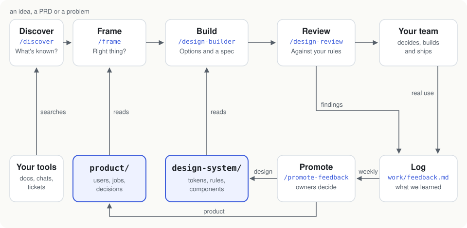
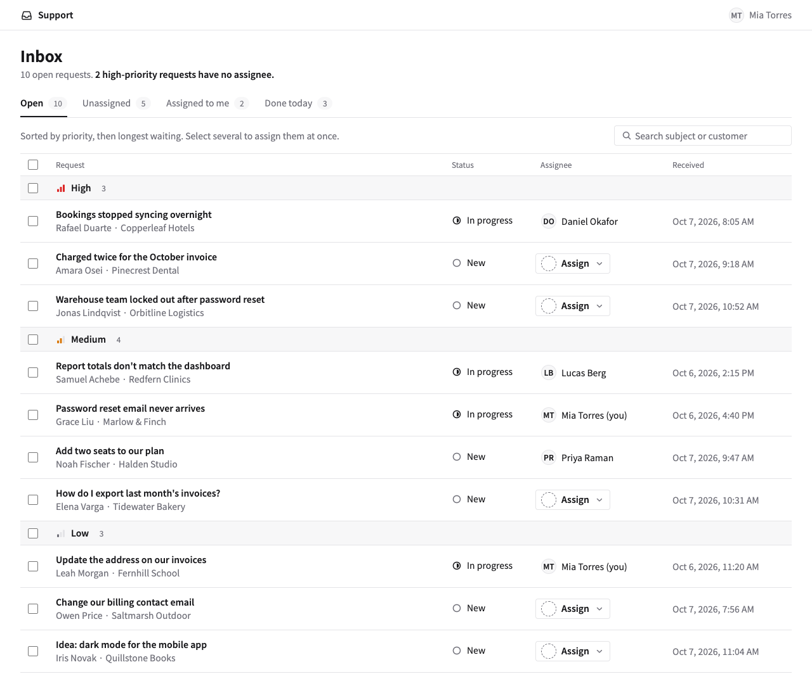

# AI Design Harness

A Claude Code plugin that helps an AI agent do product design the way your team would. It works with or without a designer, and with or without a design system.

The harness is a few folders of short notes in your repo: who your users are, what they're trying to get done, what you've already decided, and how your product looks and talks. The agent reads them before it does anything.

Before anyone writes code, it does three things:

1. **Finds out what's already known.** It searches your docs, chats and tickets, and looks at other products for bigger work. No PRD (a product requirements doc) yet? It drafts one.
2. **Checks you're building the right thing.** The request is matched against your users, what they're trying to get done, and the decisions you've already made. If it clashes, it stops there and says why.
3. **Designs it the way your team would.** For bigger work it first sketches rough directions for you to pick from. Then it drafts a few clickable options with your own design system, recommends one, writes the spec and reviews it against your rules.

What it learns along the way goes back into your product and design notes, so the next round starts from there.



## See it (2 minutes)

Clone this repo and open `examples/support-inbox/proposal.html` in a browser. It's a full run for a made-up support inbox: the check against the product, three clickable mockups, the recommendation, the spec and the review.



## Try it (15 minutes)

The repo comes with example notes for Helpline, a made-up help desk, so you can try it without installing anything. Clone it, open it in Claude Code, and ask:

| Ask | What happens |
|---|---|
| "Should we build examples/prd/community-forum.md?" | It says no: customer log-ins go against a decision Helpline already made. |
| "Is examples/prd/hand-off.md ready to design?" | It sees a flow of four screens, and comes back with one question a product owner should answer first. |
| "Design examples/prd/support-inbox.md." | It checks the request, asks a few questions, builds three options and reviews its pick. |

You need Claude Code, Node 20 or later, and git.

## Use it on your product

1. **Add the plugin.** In Claude Code, once per machine:

   ```
   /plugin marketplace add sadakoa/AI-design-harness
   /plugin install design-harness@ai-design-harness
   ```

2. **Open your product's repo and say "Set up the design harness."** It makes a branch, adds a few folders, and drafts them from your code, docs and commit history: who uses the product, what they're trying to do, the decisions you've made, and your colors, type and words. It never overwrites anything, and it starts small.

3. **Check its drafts and merge.** It tells you what it guessed and what to check first. Fix those, confirm the decisions it found in your history, put your owners in `.github/CODEOWNERS`, and merge.

That's it. From then on, you just ask.

If your product has a design system or a component library, the harness reads its colors, type and components from your code and never writes to it. If it doesn't, the harness starts from what your product already uses.

Connecting Notion, Slack or Google Drive to Claude Code lets it look things up itself. Using Codex, or want everything in your repo instead of a plugin? See [Adopting it](docs/adopting.md).

## Day to day

Talk to it like a colleague, in your own words and language.

| You say | You get |
|---|---|
| "Can we add saved replies?" or a PRD, or a request from Sales | A short, plain answer first: go, a question for a product owner, or why not. Then, if it's a go, a reviewed proposal with clickable options. |
| "What do we know about why leads miss overloaded agents?" | A short brief with sources, and a PRD draft if there wasn't one. |
| "Option B, but without the dialog." | A second round next to the first, saying what changed. |
| "Check this page before Friday." | The fixes in order, the important ones first. |
| "Here's what five team leads told us." | Notes logged with their source, for an owner to fold in. |
| "This design is approved." | A pull request that adds it to your design system. |
| "Go through the feedback." (owners, after a feature merges or once a week) | What was learned, sorted, and pull requests that fold it into your product and design notes. |

For a new feature, ask it to make a branch first, and for a pull request when you're happy. The proposal stays in the repo, so the next round knows what's in flight. Engineers build from its spec as usual. If your team designs in Figma or straight in code, skip the design step; the checks and reviews still work.

**What to expect early on.** The first few checks will mostly say go, or ask a question: it can only say no when a decision has been written down. Each time it finds a decision nobody wrote down, it notes it for an owner, so this fills in as you go.

**When something gets in the way**, like too many questions, say so. It notes it. If you say "send it to the harness", it drafts issues for this repo with nothing about your product in them, and files them after you say yes.

**Updates** come with the plugin. Say "update the harness" in your repo to refresh the few files it copied there; your notes are never touched.

## What it adds to your repo

```
product/          who it's for, what they need, what you've decided
design-system/    your colors, type, words, rules and components
work/             proposals, reviews, and a log of what you've learned
```

Plus a few small scripts, and a check on pull requests that catches broken links between the notes. Your plans, research and PRDs stay where they are; the harness keeps a short version and links to the rest.

Owners approve changes to `product/` and `design-system/`: usually a product lead and a design lead. In the notes you'll see IDs like `J-01` (a job: something a user is trying to get done). They let the agent point to the reason behind a choice; you don't need to learn them.

## Not for

Screens unlike anything your product has today, say your first dashboard: the agent can draft options, but someone with design experience should finish them. It doesn't write production code either. It gets you to a reviewed design; building it is still your job.

## More

- [How it works](docs/how-it-works.md): the ideas behind it, with pictures
- [Adopting it](docs/adopting.md): setup details, Codex, updates, owners, and the slash commands if you'd rather be explicit
- [Slide deck](docs/slides/ai-design-harness.pdf) (to present from a browser, open `docs/slides/index.html`)

This repo is the plugin itself: `skills/`, `scripts/`, `examples/` and `evals/`. Changed a skill? Ask the agent here to run the evals, eighteen requests from a designer's PRD to a one-line ask from Sales. See [evals/README.md](evals/README.md).

[MIT License](LICENSE)
